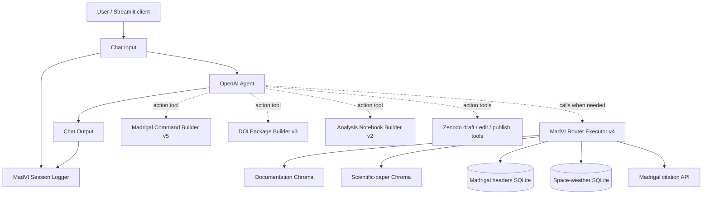

# MadVI Langflow Architecture and Replication Guide

**Snapshot:** `MadVI Alpha(20261030-200122).json` (30 October 2026)  
**Flow:** `MadVI Alpha`  
**Flow ID:** `88b04b17-2029-4bf0-9301-dc7c8772003a`  
**Component version indicated in the export:** Langflow `1.6.0` (individual component metadata)  
**Scope of this document:** The graph, configuration, and embedded custom-node code in the exported JSON. External Streamlit/ngrok deployment is described separately because its source code is not contained in this export.

## 1. What MadVI does

MadVI is a domain-specific conversational assistant for the **Madrigal geospace/ionospheric data ecosystem**. It uses an LLM to interpret user requests while delegating scientific information access to specialized tools. The flow supports Madrigal documentation and literature retrieval, structured scientific metadata queries, Madrigal command generation, citation creation, reproducibility-package generation, analysis notebooks, and Zenodo deposit workflows. The present router also includes separate space-weather metadata retrieval (e.g., Kp, Ap and F10.7) and joins with Madrigal metadata.

The central architectural choice is a **single front-door router for read-oriented scientific questions**. Rather than let the Agent independently select documentation search, paper search, SQL or citation tools, these operations are implemented *inside* `madvi_router_executor_v4`. Other explicit actions—command generation, package construction and Zenodo operations—remain separate Agent tools.

## 2. High-level flow



**Important:** Dashed tool arrows represent the tools *available to the Agent*, not sequential execution for every user prompt. The Chroma and SQLite sources are accessed internally by Python code in the router at runtime, **not through graph edges from their visual ingestion nodes**.

### Runtime connections confirmed in the exported graph

- `Chat Input (ChatInput-Gv3QX)` → `Agent (Agent-txz78)` → `Chat Output (ChatOutput-rLL6C)`.
- `Chat Input` and `Chat Output` → `MADVI Session Logger (MADVI_Logger-OnDEb)`.
- Eight custom tools connect via their `component_as_tool` output to `Agent.tools`: Router v4, Command Builder v5, DOI Package v3, Analysis Notebook v2, Create Zenodo Draft v5, Edit Zenodo Draft v2, Publish Zenodo Draft v2, and Edit Published Zenodo Metadata v2.
- The graph also contains ingestion components and **unconnected** components, described below.

## 3. Component inventory

The exported graph has **27 nodes and 20 edges**. The following table distinguishes live Agent-connected tools from visual ingestion and disconnected nodes.

| Component (exported node) | Responsibility | Connection/status |
|---|---|---|
| Chat Input `ChatInput-Gv3QX` | Receives end-user message | Connected to Agent and Logger |
| Agent `Agent-txz78` | Orchestrates model/tool calls; formats user answer | Main runtime controller |
| Chat Output `ChatOutput-rLL6C` | Returns Agent response | Connected to Agent and Logger |
| MADVI Session Logger `MADVI_Logger-OnDEb` | Appends user/assistant interaction records to `madv_sessions.jsonl` | Receives chat edges; status output unconnected |
| MadVI Router Executor v4 `CustomComponent-lonZj` | Scope check; internal Docs/Papers/SQL/Citation routing and execution | **Connected Agent tool** |
| Madrigal Command Builder v5 `CustomComponent-4ipRP` | Produces metadata-aware Madrigal retrieval commands | **Connected Agent tool** |
| Build DOI Package v3 `CustomComponent-cXpgy` | Constructs reproducibility artifacts and package registry entries | **Connected Agent tool** |
| Build Analysis Notebook v2 `CustomComponent-Aaqx8` | Generates analysis notebook, uses package/registry context | **Connected Agent tool** |
| Create Zenodo Draft v5 `create_zenodo_draft_v5-ewhuW` | Creates draft deposits and uploads/associates package files | **Connected Agent tool** |
| Edit Zenodo Draft v2 `CustomComponent-U1hEk` | Modifies draft deposit metadata | **Connected Agent tool** |
| Publish Zenodo Draft v2 `publish_zenodo_draft_v2-VLUPg` | Publishes an existing draft | **Connected Agent tool** |
| Edit Published Zenodo Metadata v2 `edit_published_zenodo_metadata_v2-YU7eW` | Updates metadata for an already-published Zenodo record, as supported | **Connected Agent tool** |
| Search Madrigal Headers SQL `search_madrigal_headers_sql-Nc0b1` | Earlier stand-alone SQL search component | **Disconnected**; do not assume Agent can call it |
| Message History (Retrieve) `Memory-027A0` | Stand-alone history retrieval | **Disconnected** |
| Message History (Store) `Memory-KRqaz` | Stand-alone history storage | **Disconnected** |
| File `File-QWMEG` → Split Text `SplitText-zT2Up` → Chroma `Chroma-D3A65` | Legacy/general document ingestion | Ingestion chain, not linked to Agent |
| Embedding Model `EmbeddingModel-dpEAZ` | OpenAI embeddings for above Chroma | Connected to Chroma ingestion |
| Load CSV `CSVtoData-4WxLI` → Paper Card Builder `MadrigalPaperCardBuilderQ1Q7Exact-guxUe` → Chroma `Chroma-P8mri` | Structured paper-summary ingestion | Ingestion chain, not linked to Agent |
| Embedding Model `EmbeddingModel-F6Tnb` | Paper Chroma embeddings | Connected to Chroma ingestion |
| File `File-kFFNC` | Separate file loader | **Disconnected** in this snapshot |
| Split Text `SplitText-JdSXU` → Chroma `Chroma-rguxR` | Separate documentation-like ingestion chain | Has no incoming File edge in this snapshot |
| Embedding Model `EmbeddingModel-gU2b2` | Chroma embeddings for above chain | Connected to Chroma ingestion |

### Agent settings recorded in the JSON

The Agent node uses OpenAI model **`gpt-5.5`**, temperature **0.1**, maximum **15 iterations**, timeout **700** (component field), 5 retries, and 100 messages of conversation history. Its prompt emphasizes grounded results, one tool by default, beginner-friendly guidance, and no fabricated citations/metadata. **This is the exported configuration, not a benchmarked performance claim.**

**Configuration mismatch requiring attention:** The Agent's saved system prompt refers repeatedly to `madvi_router_executor_v1`, while the actual connected tool is **`madvi_router_executor_v4`**. The prompt also mentions an older independent citation-group action even though citation-group execution now lives within the router. Update the Agent prompt/tool names before treating the JSON as a clean deployment reference. Do not automatically reintroduce the old independent citation tool.

## 4. The router: central scientific query executor

**Node:** `CustomComponent-lonZj`  
**Custom component name:** `madvi_router_executor_v4`  
**Implementation:** substantial embedded Python code in the Langflow export; the JSON's component node stores the code.

The router accepts a textual user query, validates its domain, selects an internal operation and returns a source-labeled response. Its source code implements four principal routes:

1. **`DOCS`** — Embed query using OpenAI `text-embedding-3-small`, search a persisted Chroma documentation collection, filter/rank results and return documentary evidence.
2. **`PAPERS`** — Embed query and search a *separate* Chroma collection of scientific-paper summaries, with additional relevance scoring.
3. **`HEADERS_SQL`** — Run controlled SQLite queries against indexed Madrigal file/instrument/parameter metadata. Date parsing supports years, named months and exact dates; science-product terminology can map to Madrigal parameter mnemonics. The implementation additionally attaches the separate space-weather database for Kp/Ap/F10.7/SN queries and date-based joins.
4. **`MADRIGAL_CITATION`** — Use `madrigalWeb` API calls to retrieve Madrigal-native file citations; supports previews/dry runs and explicit creation of persistent citation groups.

The **Madrigal-only scope gate** rejects clearly unrelated requests with an `OUT_OF_SCOPE` response. This is distinct from the Agent's conversational guidance. The code also avoids inventing numerical thresholds for qualitative conditions such as “high geomagnetic activity.”

The ordering matters: explicit literature intent is checked before structured metadata intent, preventing paper-publication dates from being treated as dataset-coverage filters. The router maintains deterministic scientific schema mappings and database execution rather than trusting an LLM to invent SQL columns or parameters.

**Local runtime dependencies referenced by the router:**

```text
/home/domo/Langflow311/madrigal_headers.db
/home/domo/Langflow311/space_weather.db
```

These database files are **not embedded in the JSON export**. A new machine needs compatible copies or paths updated in the component fields/code. The exact Chroma collection/directory names used *inside the router code* are authoritative for live retrieval; do not assume the visual Chroma nodes are the same collections.

## 5. Data ingestion branches (not the runtime query path)

### 5.1 Generic/legacy text collection

```text
File-QWMEG → SplitText-zT2Up → Chroma-D3A65
                     EmbeddingModel-dpEAZ ↗
```

- File loading and character-based chunking: **700 characters** with **100-character overlap**.
- OpenAI embeddings: `text-embedding-3-small`.
- Chroma collection **`MadVagentZ`**, persistence directory **`./MadVagentZ`**.
- This is a populated *visual ingestion pathway*, **not** an Agent search tool in the current graph.

### 5.2 Structured scientific-paper summaries

```text
Load CSV → Madrigal Paper Card Builder (Q1–Q7 Exact) → Chroma-P8mri
                                           EmbeddingModel-F6Tnb ↗
```

- The CSV node outputs tabular data; a custom builder turns rows into structured paper cards that capture the Q1–Q7 fields.
- Chroma collection **`madrigal_papers_table2`**, directory **`./madrigal_papers_table2`**.
- Embedding model: `text-embedding-3-small`.
- The runtime router also references this paper collection, but its searches are performed internally by its own Python, not via a visible Chroma→Agent edge.

### 5.3 Additional documentation-like collection

```text
[No connected source] → SplitText-JdSXU → Chroma-rguxR
                                  EmbeddingModel-gU2b2 ↗
```

- Configured splitter: **1,200-character chunks**, **200-character overlap**.
- Chroma collection **`madrigal_html2`**, directory **`./madrigal_html2`**.
- The exported graph does **not** show a File input wired to this splitter; `File-kFFNC` is also disconnected.
- **Potential discrepancy:** The previously implemented router references a separate documentation collection named `madrigal_html_docs_3`. Inspect the embedded router code and existing persistence directories before using the visible `madrigal_html2` Chroma as the runtime docs source. A visible Chroma node does not automatically supply the router's backend index.

## 6. Action and reproducibility tools

### Madrigal Command Builder v5

Converts user requirements into Madrigal command-line invocations, applying date, instrument and parameter checks against Madrigal metadata when available. The code references `madrigal_headers.db`. Intended for command generation, not documentation/paper search. A generated command is a reproducible instruction, **not evidence that data were successfully downloaded**.

### Build DOI Package v3

Assembles an intermediary research package with metadata, retrieval context, and supporting files. The code references a local registry `madvi_registry.db`. “DOI-ready” means prepared for deposit; it does **not** imply an issued DOI.

### Build Analysis Notebook v2

Creates a Jupyter analysis notebook for a selected research package / Madrigal data context and can look up package paths through `madvi_registry.db`. Its outputs and dependencies should be inspected before claiming an independently executed scientific analysis.

### Zenodo workflow

The current Agent has four separate Zenodo tools:

```text
Create draft v5 → Edit draft v2 → Publish draft v2
                             ↘ Edit published metadata v2 (after publication)
```

These tools are individually available to the Agent; the graph **does not hardwire** the sequence. All four display `use_sandbox=True` in the export, meaning the current configuration targets a sandbox/testing mode. Changing to production requires explicit review, valid credentials, and confirmation for publication. API credentials are not included in this document.

## 7. User messages, chat history and logging

- `Chat Input` feeds the Agent directly; the Agent's native conversation-memory setting is **100 messages**.
- Two stand-alone Message History nodes exist in the graph but have **no edges**, so do not describe them as active memory middleware.
- `Chat Output` emits the Agent's answer.
- `MADVI Session Logger` receives both user and assistant messages and writes one JSON line to **`madv_sessions.jsonl`** when its `build_output` method is executed. The saved code includes timestamp, `session_id`, `user_message`, `assistant_message`, and `history_text`.
- **Logging caveat:** The logger's `log_status` output is not wired to another node, and neither `history_text` nor `session_id` has an incoming edge in the exported graph. Whether/how frequently the logger executes and how session IDs are supplied must be verified in a live deployment; graph presence alone does not prove a complete logging pipeline. This matters because historical evaluation logs included shared-session/history duplication issues.
- In the external Streamlit architecture used by MadVI, a separate `madvi_session_id` should be supplied per browser/conversation when calling Langflow. **The Streamlit implementation itself is not inside this export.**

## 8. Recreating this flow on another machine

1. **Install a compatible Langflow environment.** The export labels components as Langflow 1.6.0; use compatible custom-node Python and library dependencies. Dependencies visible in custom code include `chromadb`, `langchain_openai`, `madrigalWeb`, SQLite, and the Zenodo HTTP/tool stack; inspect imports in individual custom nodes to generate an exact environment lockfile.
2. **Import the JSON into Langflow.** Verify that all custom component code and tool ports load successfully. An import alone does not provide the required databases, source documents, API keys, filesystem directories, or frontend.
3. **Configure secrets outside source control.** Supply OpenAI credentials and Zenodo sandbox/production credentials as required. Never commit active API keys or access tokens in export JSON, app scripts or documentation.
4. **Rebuild or restore Chroma collections.** Ingest the appropriate source files or copy compatible persistence directories. The two collections needed at runtime are the names configured in the **router's embedded code**, regardless of legacy visual nodes. For paper summaries, inspect the CSV Q1–Q7 schema before rebuilding.
5. **Restore SQLite files:** Madrigal headers database, space-weather database, and the reproducibility registry where relevant. Update file paths from `/home/domo/Langflow311/...` to the new server's actual locations.
6. **Correct the Agent prompt/tool-name mismatch:** change legacy `madvi_router_executor_v1` references to the connected `madvi_router_executor_v4` and remove references to unavailable stand-alone tools.
7. **Run smoke tests in Langflow Playground:** documentation query, scientific-paper query, exact file/day metadata query, a Kp-filtered query, a command-generation query, a citation dry run, and a clearly out-of-domain request (e.g. recipe). Confirm expected tool calls in traces, not just plausible answer text.
8. **Test state-changing workflows separately in Zenodo sandbox.** Do not publish to Zenodo production as an initial smoke test.
9. **Connect an external frontend if required.** The MadVI deployment described in the project uses Streamlit calling the Langflow `/api/v1/run/{flow_id}` endpoint. The frontend is commonly exposed via ngrok during testing; Langflow and API keys should remain private. Configure session IDs and authentication in the frontend; the export does not implement a user quota system.
10. **Confirm logs, permissions, and deployment hardening** (persistence, file paths, session isolation, rate limits, origin authentication, process supervision and backup). Treat worldwide ngrok exposure as a test deployment unless those protections are implemented.

### Example API shape (adapt to your Langflow installation)

```python
import os
import requests

flow_id = "88b04b17-2029-4bf0-9301-dc7c8772003a"
url = f"http://127.0.0.1:7860/api/v1/run/{flow_id}"

payload = {
    "input_value": "How many ISR electron-density days were available in August 2019?",
    "input_type": "chat",
    "output_type": "chat",
    "session_id": "madvi_test_session_001",
}
response = requests.post(
    url,
    json=payload,
    headers={"x-api-key": os.environ["LANGFLOW_API_KEY"]},
    timeout=180,
)
response.raise_for_status()
print(response.json())
```

**API compatibility note:** This illustrates the project's previously used API route and parameters; confirm them against the exact imported Langflow version. The request/response structure is not specified by the exported graph itself.

## 9. Known discrepancies and reproducibility limitations in this snapshot

| Observation | Why it matters |
|---|---|
| Agent prompt says router `v1`, wired component is router `v4` | Tool selection can fail or become inconsistent; fix instructions to match installed tool name |
| Old stand-alone SQL tool exists but is disconnected | Use router's internal `HEADERS_SQL`; do not wire the old tool unless intentionally redesigning routing |
| Message History retrieve/store nodes are disconnected | Conversation behavior comes from Agent settings / caller session IDs, not these history nodes |
| `File-kFFNC` is disconnected and one splitter lacks input | Visual documentation ingestion branch may be incomplete or stale |
| Visual docs Chroma uses `madrigal_html2`; router uses its own configured collection | Validate actual corpus names and persisted directories rather than assuming a visual node controls live retrieval |
| Logger status output not connected; session ID input not wired | Confirm log execution and session association under API calls |
| Filesystem paths are hardcoded to one workstation | Reproducers must configure paths and include source DB/index artifacts separately |
| Zenodo nodes have sandbox enabled | These settings are for testing; publication is a separate deliberate operation |
| Full input source datasets and external Streamlit app are not in the JSON | Flow JSON is **not a self-contained reproduction package** |

## 10. Suggested repository layout

```text
madvi/
├── README.md                         # Project overview
├── docs/
│   ├── LANGFLOW_ARCHITECTURE.md      # This document
│   ├── architecture_diagram.drawio   # Optional editable diagram
│   └── evaluation_methodology.md     # Optional: separate evaluation details
├── langflow/
│   └── MadVI_Alpha_2026-10-30.json   # Scrubbed flow export
├── components/                       # Optional extracted, versioned custom nodes
│   ├── madvi_router_executor_v4.py
│   ├── madrigal_command_builder_v5.py
│   └── ...
├── app/                              # Streamlit source (separate from the flow export)
├── scripts/                          # Database/index builder scripts
├── tests/                            # Routing and workflow regression examples
└── .env.example                      # Environment variable names only; never secrets
```

**Security review before pushing the exported JSON:** custom component code may carry local paths, prompt text, model settings, API URLs, logs, and potentially secrets in custom fields. Review/sanitize the entire export; do not assume the visually blank credential fields guarantee that every embedded custom-code literal is safe to publish. Do not publish the raw user interaction logs without reviewing privacy and consent requirements.

---

**Interpretation rule:** The export confirms the topology, stored component settings, and embedded code, but does **not** by itself prove external service availability, that any ingestion branch has been executed, that all connected tools work successfully, or that disconnected components participate at runtime. Those properties require live tests and external artifacts.
